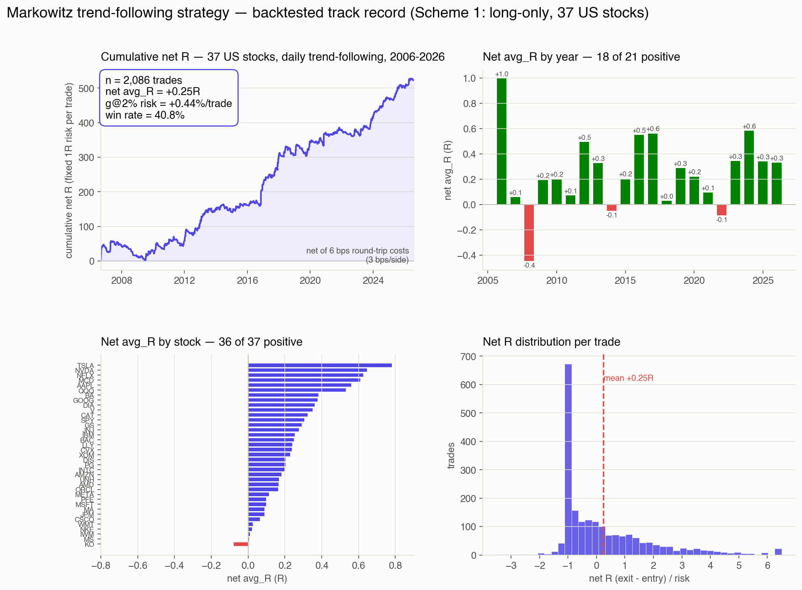

<p align="center">
  
</p>

<h1 align="center">Swing — Day-K Trend-Following Strategy (US Equities)</h1>

<p align="center">
  <a href="LICENSE.md"></a>
  
  
  
  
</p>

<p align="center">🌐 <a href="README_cn.md">简体中文</a></p>

**Swing** is a fully documented, backtest-validated **daily-K trend-following strategy** for US large-cap equities, developed by [Markowitz](https://github.com/xhqing/QuantStrategistAgent) (the quant-strategist agent of the [xhqing AI agent team](https://github.com/xhqing)).

> **This is not a black box.** The complete strategy logic, parameters, validation methodology, honest limitations, and a list of falsified alternatives are all in the open — see [`trend/STRATEGY.md`](trend/STRATEGY.md). Trend-following is public knowledge (Donchian breakout / turtle trading); what this repo adds is **rigorous validation of that public knowledge on 20 years of data**.

---

## The Strategy in One Line

**Close breaks the 20-day high on ≥1.5× average volume → buy next day's open; 2×ATR fixed stop cuts losers, 3×ATR trailing stop lets winners run, 60-day timeout as backstop.**

Classic Donchian breakout + volume confirmation + ATR trailing — i.e., time-series momentum, deliberately left unfiltered (every tested "improvement" made it worse).

## Validation Highlights (2006–2026, 37 US stocks/ETFs, long-only)

| Metric | Value |
|---|---|
| Pooled trades | 2,086 |
| Net expectancy | **+0.251R per trade** (log growth +0.444%/trade) |
| Positive-g stocks | 34 / 37 (92%) |
| Positive years | 18 / 21 |
| Walk-forward OOS | **Zero degradation** vs in-sample (no overfitting) |
| Median holding | 13 days |

<p align="center">
  
</p>

Honest caveats (full list in STRATEGY.md §11): monthly win rate is only 54% — roughly half of all months are flat-to-negative; ~1/3 of years lose money in choppy/crisis regimes; the worst single trade is −5.58R on an overnight gap. **This is a "lose small often, win big occasionally" system, and the position-sizing rules (§8) exist precisely because of that tail.**

## Candidate Strategy: A-Share ETF Momentum Rotation

Alongside the main strategy, this repo documents a **candidate-grade** ETF momentum-rotation strategy for Chinese A-share ETFs (35-fund multi-category pool): 22-day weighted log-regression momentum score × R², top-3 equal-weight holdings, rebalanced every 5 trading days with a rank buffer. Backtest 2013–2026 (Tencent daily-K, real costs): net CAGR 19.8%, Sharpe 0.81, max drawdown −30% — though walk-forward and parameter tests reveal overfitting components, so the honest expectation is **12–16%/yr**. Full spec, evidence chain, and usage boundaries: [`rotation/ROTATION.md`](rotation/ROTATION.md).

## Quick Start

Requires Python 3 + pandas (+ Futu OpenD for data fetching).

```bash
# 1. Fetch daily-K data (run once, keep OpenD online)
cd engine && python3 data.py fetch-all --ktype DAY

# 2. Check today's signals for all 37 symbols (run after US close daily)
cd ../trend && python3 check_signal.py

# 3. Full backtest (recommended scheme 1)
python3 backtest.py --scheme 1
python3 backtest.py --all       # compare all 4 schemes

# 4. Analysis dimensions
python3 analyze.py monthly      # monthly return distribution
python3 analyze.py hold         # holding-period distribution
python3 analyze.py yearly       # year-by-year breakdown

# 5. ETF rotation signals (candidate strategy; run after A-share close every ~5 trading days)
cd ../rotation && python3 rotation.py fetch-pool && python3 rotation.py signals
```

## Repository Layout

```
├── trend/            # Main strategy (trend-following): check_signal / backtest / analyze + full docs
│   └── STRATEGY.md   # ★ Complete main-strategy documentation — start here
├── rotation/         # Candidate strategy: A-share ETF momentum rotation
│   ├── ROTATION.md   # Complete rotation strategy documentation
│   └── rotation.py   # Rotation backtester + signal CLI (shares engine/ data layer)
├── engine/           # Shared data layer (data.py: Futu + Tencent sources) + backtest engine + strategies
└── assets/
```

## Disclaimer

This repository is for research and educational purposes. **Nothing here is investment advice.** Backtest results do not guarantee live or future performance. Trade at your own risk.

## License & Attribution

This project is licensed under the [MIT License](LICENSE.md).

- Copyright (c) 2026 All Contributors
- If you use or reference this repository, please retain the copyright notice and credit the source: [https://github.com/xhqing/Swing](https://github.com/xhqing/Swing)
